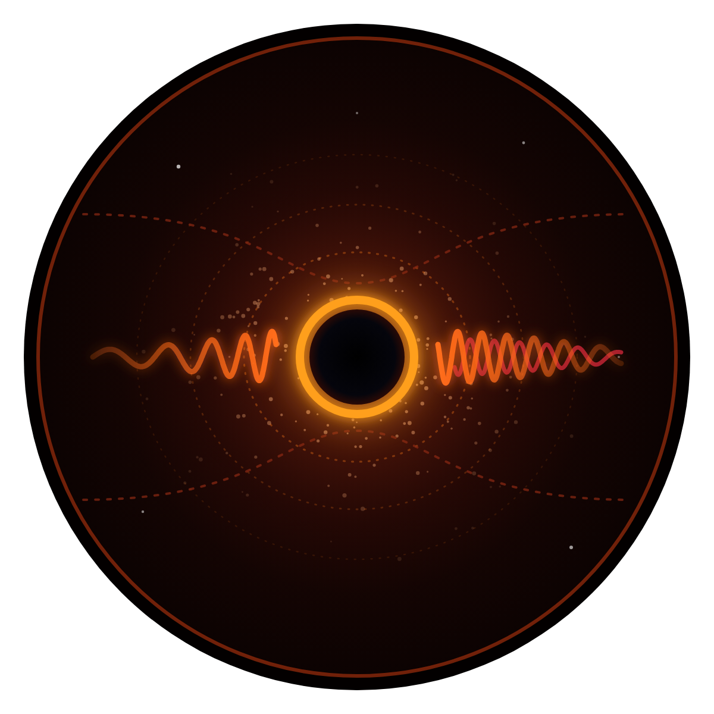

  

<h1 align="center">GWLENS</h1>

<b>Gravitational Wave Lensing Exploration of Non-visible Structures</b>

  
  
  
  

The documentation can be found here: https://hsreekanth15.github.io/GWLENS/

